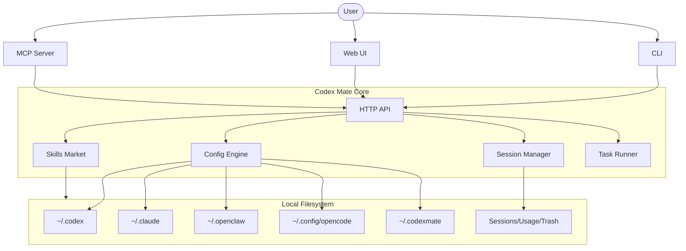

<div align="center">


# Codex Mate

**Find the conversations scattered across your AI coding tools.**

Codex Mate is a locally running CLI + Web tool for browsing, filtering, and exporting existing sessions in one place, with Provider, Skills, and task management when you need them.

<p>
  <a href="https://sakurabytecore.github.io/codexmate/">[Documentation]</a>
  <a href="#quick-start">[Quick Start]</a>
  <a href="README.zh.md">[简体中文]</a>
  <a href="README.vi.md">[Tiếng Việt]</a>
</p>

[](https://www.npmjs.com/package/codexmate)
[](https://github.com/SakuraByteCore/codexmate/actions/workflows/release.yml)
[](https://www.npmjs.com/package/codexmate)
[](#install-via-homebrew-macos--linux)
[](#quick-start)
[](https://nodejs.org/)
[](LICENSE)
[](https://github.com/SakuraByteCore/codexmate/stargazers)
[](https://github.com/SakuraByteCore/codexmate/issues)
[](https://stackmap.shipwithai.xyz/repos/SakuraByteCore/codexmate?utm_source=badge)

<br />

</div>

### Session workbench

The session page adds message bookmarks with notes and tags, an incremental local full-text index, evidence-linked handoff drafts, a read-only project workspace, and model-window references. Bookmarks do not modify source sessions. The index covers discovered candidates only; refresh it for new messages. Historical text ratios are not actual request utilization. Settings offers local diagnostics and redacted JSON/Markdown exports. Only selected checks probe the current Codex route or start selected MCP servers; no write tools are called. See the [session guide](https://sakurabytecore.github.io/codexmate/guide/sessions).

---

> [!TIP]
> **Local First**: Read existing sessions and manage configuration on your machine. No telemetry or Codex Mate cloud account required. Model requests still go to your configured provider; running locally does not mean models run offline.

## What is Codex Mate?

Was last week's solution discussed in Codex or Claude Code? Narrow down your local sessions by source, project, or time, open the conversation, and export it as Markdown for reference.

Codex Mate manages existing tools and local records. It is not a new AI model or a replacement for your coding assistant. Start by finding one useful conversation, without configuring every tool first.

[Get started](#quick-start) · [Session guide (Chinese)](https://sakurabytecore.github.io/codexmate/guide/sessions) · [Thread handoff](#thread-handoff)

## Comparison with Related Tools

Choose by primary use case rather than treating this as an exclusive feature checklist. These projects overlap and can be used together.

| Tool | Primary focus | Best fit |
| --- | --- | --- |
| **Codex Mate** | Local-first, cross-tool session and configuration management through CLI + Web and desktop entry points | Find, filter, and export conversations from different tools in one place, alongside Provider, Skills, and task workflow management |
| [CC Switch](https://github.com/farion1231/cc-switch) | Desktop configuration manager for multiple AI coding tools, covering providers, MCP, Skills, and prompts | Switching API providers and reducing manual edits to each tool's configuration files |
| [CloudCLI (Claude Code UI)](https://github.com/siteboon/claudecodeui) | Desktop and mobile Web UI for Claude Code, Cursor CLI, and Codex | Using coding assistants from a browser or phone and accessing local or remote projects and sessions |
| [ccusage](https://github.com/ryoppippi/ccusage) | CLI for analyzing token usage and costs from local coding-agent records | Daily, weekly, monthly, or per-session usage and cost reports |

**Why choose Codex Mate?** Bring cross-tool conversation lookup, Markdown archiving, and everyday configuration, Skills, and task management into one entry point without replacing your coding assistant.

This comparison follows the official project descriptions linked above; it does not imply that other tools lack unlisted features and is not a performance or pricing ranking. Codex Mate's session operations vary by source; see the [session guide (Chinese)](https://sakurabytecore.github.io/codexmate/guide/sessions). Export and handoff do not provide lossless migration of complete session state, and running locally does not mean models run offline.

## Quick Start

For CLI + Web, install via Homebrew, npm, or curl below, then run `codexmate run`. Open the address printed in your terminal, select a source with existing records in the session browser, open a conversation, and use its export action. If there are no local records, create a conversation in the original tool first.

Exports are for reading and archiving, not restoring complete agent state in another tool. Use `codexmate setup` when you need to configure a provider. See the [quick-start guide (Chinese)](https://sakurabytecore.github.io/codexmate/guide/quick-start) for details.

### Install the Desktop App

Open the [latest release](https://github.com/SakuraByteCore/codexmate/releases/latest). Windows `.exe`, macOS `.dmg`, and Linux `.AppImage` packages appear in **Assets** only after the desktop builds complete. Download the package for your platform, install it, and launch the desktop app directly; `codexmate run` is not required.

### Install via Homebrew (macOS / Linux)

```bash
brew tap SakuraByteCore/codexmate
brew install codexmate
```

Requires [Node.js](https://nodejs.org/) (`brew install node` if not present).

### Install via npm

```bash
npm install -g codexmate
codexmate run
```

If the default Web UI port `3737` is unavailable, Codex Mate automatically tries the next ports (`3738`, `3739`, ...). To force a fixed port, set `CODEXMATE_PORT`:

```bash
CODEXMATE_PORT=8080 codexmate run
```

Windows PowerShell:

```powershell
$env:CODEXMATE_PORT=8080; codexmate run
```

### Install via curl (Standalone)

```bash
curl -fsSL https://raw.githubusercontent.com/SakuraByteCore/codexmate/main/scripts/install.sh | bash
```

### Supported Agents

- **Codex**: `npm install -g @openai/codex`
- **Claude Code**: `npm install -g @anthropic-ai/claude-code`
- **Gemini CLI**: `npm install -g @google/gemini-cli`
- **CodeBuddy**: `npm install -g @tencent-ai/codebuddy-code`
- **KiloCode**: `npm install -g @kilocode/cli` (`kilo` / `kilocode`)
- **OpenCode**: install from the [official OpenCode docs](https://opencode.ai/)
- **OpenClaw**: see the [OpenClaw repository](https://github.com/moeru-ai/openclaw)
- **Pi**: sessions are discovered from `~/.pi/agent/sessions`; provider config lives in `~/.pi/agent/models.json` and the default provider/model in `~/.pi/agent/settings.json`
- **Zed**: agent sessions are read from Zed's local database (`threads/threads.db` under its data directory) and listed in the session browser (read-only)

---

## Thread handoff

Share a structured handoff card with a target agent through a shared-memory MCP. This does not restore complete session state. Save a `card.json` containing a `goal` string and string arrays for `completed`, `blockers`, `nextSteps`, and `files`:

```json
{
  "goal": "Finish the documentation update",
  "completed": ["Reviewed the session guide"],
  "blockers": [],
  "nextSteps": ["Check the translated examples"],
  "files": ["README.md"]
}
```

Run from the source checkout; after installation, replace `node cli.js` with `codexmate`:

```bash
node cli.js thread handoff <thread-id> --card <json-file> --target <agent>
node cli.js thread list <thread-id>
node cli.js thread fallback <thread-id> --handoff <id>
node cli.js thread ack <thread-id> --handoff <id> --agent <target> --evidence <session-or-retrieval-id>
```

Use the handoff's returned ID for `<id>`, the same target agent for `<target>`, and an actual session or retrieval ID for the evidence. Run `ack` only after the target reports reading the card.

- **File first, bounded MCP routing**: Save handoff files under `~/.codexmate/threads/<hash>/` first. Discover shared-memory MCPs by reading the project's `.mcp.json`, Claude user configuration, and Codex `config.toml` without modifying them. Select one MCP with a compatible native write tool and use a short-lived connection, not a daemon. Compatibility with arbitrary MCP versions is not guaranteed. No new dependencies or forced prompt insertion are added.
- **Explicit file fallback**: A failed MCP write does not retry automatically; the result reports the file path. `thread fallback` returns the file text. The session handoff area's copy-card button in the UI is also an explicit file fallback: paste the copied card into the target yourself; copying does not send it automatically.
- **Write success is not a read receipt**: A successful MCP write only sets `awaiting_read`, not proof that the target read the card. `thread ack` records the target's self-reported read with evidence, not an independently verified receipt.
- **Audit**: `thread list <thread-id>` returns the audit, including the selected MCP/tool, elapsed time, write result, fallback, and read status.

---

## What's So Special?

After finding your conversations, manage the configuration, skills, and tasks used in your daily work:
- **Unified Session Browser**: Browse local sessions from Codex, Claude Code, Gemini CLI, CodeBuddy Code, WorkBuddy, Pi, OpenCode, and Zed in one place. Search, export, and deletion availability varies by source; see the [session guide (Chinese)](https://sakurabytecore.github.io/codexmate/guide/sessions). Session details show an always-visible five-category token breakdown, a composition bar, and a health rating.
- **OpenAI-Compatible Bridge**: Use Codex with any OpenAI-compatible UI by normalizing the Responses API; the built-in Codex conversion also fills and normalizes Codex fingerprint headers such as `User-Agent`, `Version`, `OpenAI-Beta`, and `Originator` so upstream providers see an official Codex CLI-shaped request.
- **Claude Provider Bridge**: Connect Claude Code to OpenAI Chat Completions-compatible providers and Ollama through the built-in local Claude-compatible proxy.
- **OpenCode Provider Control**: Manage OpenCode provider/model selection with a CodexMate-owned provider store under `~/.codexmate`, projecting only the active provider into native OpenCode config to avoid polluting or deleting user-owned settings.
- **KiloCode Config Bridge**: Configure KiloCode providers from the CLI or Web UI, writing to `~/.config/kilo/kilo.jsonc` while preserving stored API keys.
- **Pi Provider Config**: Manage Pi providers from the Web UI with lossless round-trip writes to `~/.pi/agent/models.json`, auto-fetched remote model lists, and one-click default provider/model switching via `~/.pi/agent/settings.json`.
- **Provider Health Cleanup**: Probe local Codex and Claude provider routes, surface failed configs in one modal, and bulk-clean selected broken providers without touching healthy or protected entries.
- **Configuration Preview and Undo**: Preview affected paths and redacted field changes before writing any of the six tools. Detect external edits since loading or preview, and undo the latest change per tool, including after a server restart. The existing preview setting controls the dialog; turning it off keeps conflict checks and undo.
- **Skills Marketplace**: A local-first market to share and import skills between different agent apps.
- **Prompt File Editor**: Unified editor for global and project-level `CLAUDE.md` and `AGENTS.md` (including OpenCode's `~/.config/opencode/AGENTS.md`) with auto-detection of project paths, plus a shared preset pool for reusable prompts.
- **Task Orchestrator**: Automatically advance existing workflows, persist progress and results, and request intervention only when blocked.

---

## Current Progress

| Feature | Status | Description |
| --- | --- | --- |
| **Provider Management** | ✅ | Switch providers/models for Codex, Claude, OpenCode, KiloCode, OpenClaw, and Pi |
| **Live Agent Sync** | ✅ | Real-time monitoring of Codex/Claude config & status |
| **Session Browser** | ✅ | Browse and filter local sessions; search and Markdown export depend on the source. See the session guide |
| **Usage Analytics** | ✅ | Visualize message trends and top projects |
| **Local Skills Market** | ✅ | Cross-app import/export of agent skills |
| **Task Queue** | ✅ | Dependency-aware automatic workflows, persistent progress, safe recovery, and result summaries |
| **OpenAI Bridge** | ✅ | Convert Codex Responses API to standard OpenAI format and attach/normalize Codex fingerprints in the built-in conversion |
| **Claude Provider Bridge** | ✅ | Connect Claude Code to OpenAI Chat Completions-compatible providers and Ollama via the built-in Claude-compatible proxy |
| **OpenCode Provider Store** | ✅ | Keep multiple OpenCode providers in `~/.codexmate` while projecting only the selected provider to native OpenCode config |
| **KiloCode Config Bridge** | ✅ | Configure KiloCode through `codexmate kilo config` or the Web UI, writing provider URL/model/API key data to `~/.config/kilo/kilo.jsonc` |
| **Pi Provider Config** | ✅ | Manage Pi providers in the Web UI writing to `~/.pi/agent/models.json` (unknown fields preserved) and switch the default provider/model in `~/.pi/agent/settings.json` |
| **Provider Health Check** | ✅ | Probe local Codex/Claude provider routes, highlight failed configs, and bulk-remove selected broken providers safely |
| **Prompt Templates** | ✅ | Variable-fill dialog on invocation, one-template JSON sharing, and versioned plugin template configuration with history Diff and rollback. `git_diff` is pasted text, not an executed command. |
| **Prompt File Editor** | ✅ | Edit global and project-level CLAUDE.md / AGENTS.md with a shared preset pool. Presets fill variables before updating the editor; save manually to write files. History shows version Diff; confirmed rollback writes the selected version with an atomic backup and concurrent-change checks. |
| **MCP Integration** | ✅ | Expose local tools and resources via MCP stdio |
| **Auto Update** | ✅ | Quick update CLI via `codexmate update` |

---

## Unattended Workflows

Reuse existing workflow definitions and let the backend advance tasks automatically after submission. The dashboard's workflow panel supports submission, result lookup, resuming with additional input, and cancellation of subsequent steps. Closing the page does not interrupt execution; tasks do not execute while the service is stopped.

### Start and Use

Start the local service in one terminal and keep it running:

```bash
codexmate run --no-browser
```

Submit tasks from another terminal. Use the returned record's `id` as `<runId>` in subsequent commands:

```bash
codexmate workflow list --json
codexmate workflow submit diagnose-config --json
codexmate workflow active-runs --json
codexmate workflow detail <runId> --json
codexmate workflow resume <runId> --input @input.json --json
codexmate workflow cancel <runId> --json
```

- `resume` only resumes tasks waiting for intervention. Provide the complete updated input in `input.json`; omit `--input` to retain the original input.
- Write steps require explicit `--allow-write` permission and the corresponding tool configuration's write permission. Check actual side effects before resuming a write step with an uncertain outcome.
- The CLI connects to `127.0.0.1:3737` by default. For a custom port, set the same `CODEXMATE_PORT` in both terminals. When using an access token, use the same `CODEXMATE_HTTP_TOKEN` for the service and caller.
- The existing synchronous `codexmate workflow run` remains compatible. `workflow runs` reads its execution history; `workflow active-runs` reads persistent run records.

### Automatic Handling and Safety Boundaries

- Persist definition snapshots, input, node states, full output, and attempt counts. Result summaries include completed items, the final result, and reasons for unfinished work.
- After a service restart, resume confirmed-safe read-only nodes without repeating successful nodes. Write or unclassified nodes with uncertain outcomes wait for intervention instead of replaying automatically.
- Validate explicit dependencies and preserve sequential execution for existing definitions. Natural-language task decomposition is not included.
- Retry only read-only failures explicitly marked as retryable, within a finite budget. `retry` accepts `0–5` and defaults to no retries. Write operations never retry automatically.
- Missing required input or write permission pauses execution for intervention. Cancellation stops subsequent advancement; an active tool must finish before cancellation completes.
- When `timeoutMs` expires, send an abort signal but still wait for the tool to settle. Tools that do not support the signal cannot guarantee a hard timeout; the system does not falsely report termination.
- Enable `workflow-completed`, `workflow-failed`, and `workflow-waiting` in Webhook settings for completion, failure, or intervention alerts. Notification failures are recorded separately and do not change execution outcomes. Results remain queryable without notifications.

---

## Architecture



---

## Special Thanks

> [!IMPORTANT]
> This project is currently in early stage. We are seeking developers to help build the local agent ecosystem!

Special thanks to all contributors for their contributions to Codex Mate ❤️

<a href="https://github.com/SakuraByteCore/codexmate/graphs/contributors">
  
</a>

## License

Apache-2.0
