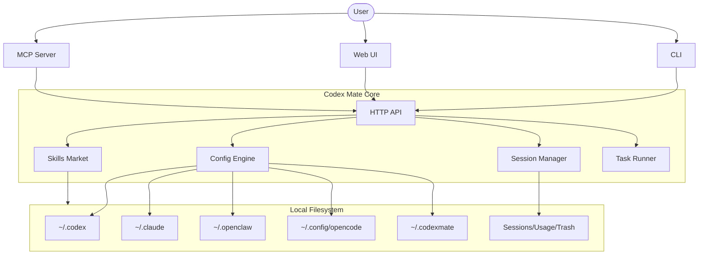

<div align="center">


# Codex Mate

**Yapay zekâ kodlama araçlarınıza dağılmış sohbetleri bulun.**

Codex Mate; gerektiğinde Sağlayıcı (Provider), Beceriler (Skills) ve görev yönetimiyle birlikte mevcut oturumları tek bir yerde taramak, filtrelemek ve dışa aktarmak için yerel olarak çalışan bir CLI + Web aracıdır.

<p>
  <a href="https://sakurabytecore.github.io/codexmate/">[Dokümantasyon]</a>
  <a href="#hızlı-başlangıç">[Hızlı Başlangıç]</a>
  <a href="README.md">[English]</a>
  <a href="README.zh.md">[简体中文]</a>
  <a href="README.vi.md">[Tiếng Việt]</a>
</p>

[](https://www.npmjs.com/package/codexmate)
[](https://github.com/SakuraByteCore/codexmate/actions/workflows/release.yml)
[](https://www.npmjs.com/package/codexmate)
[](#homebrew-ile-kurulum-macos--linux)
[](#hızlı-başlangıç)
[](https://nodejs.org/)
[](LICENSE)
[](https://github.com/SakuraByteCore/codexmate/stargazers)
[](https://github.com/SakuraByteCore/codexmate/issues)
[](https://stackmap.shipwithai.xyz/repos/SakuraByteCore/codexmate?utm_source=badge)

<br />

</div>

### Kullanım kaydı dökümü

Kaydedilen belirteçleri (token), önbellek kategorilerini ve tam kaydedilmiş metin tahminlerini ayırmak için UTC kullanım kayıtlarını isteğe bağlı olarak genişletin. Kayıt bağdaştırıcıları Codex, Claude, Pi ve Gemini JSON oturumlarını kapsar; mevcut grafikler ve varsayılan dışa aktarımlar orijinal anlamlarını korur. Maliyet hesaplaması yapılmaz. `codexmate analytics export --attribution records` komutunu kullanın. Bkz. [kullanım kılavuzu](https://sakurabytecore.github.io/codexmate/guide/sessions#%E7%94%A8%E9%87%8F%E8%AE%B0%E5%BD%95%E6%98%8E%E7%BB%86).

### Dosya paylaşımı

Dosyaları veya bir klasörü seçin, ardından açıkça yükleyin. Kopyaları indirin veya 60 dakika geçerli yerel ağ (LAN) bağlantılarını kopyalayın. İndirmeler yönetim API'si erişimi olmayan ayrı bir port kullanır. Bir grubu kaldırmak veya hizmeti durdurmak bağlantıları geçersiz kılar ve özgün dosyaları korur. Bkz. [dosya paylaşım kılavuzu](https://sakurabytecore.github.io/codexmate/guide/web-ui#%E6%96%87%E4%BB%B6%E5%85%B1%E4%BA%AB).

### Görünüm temaları

Ayarlar'da Light, Dark, Ocean veya Violet seçin. Violet, [Catppuccin Latte](https://github.com/catppuccin/palette) temasını açık yüzeyler ve mor vurguyla uyarlar. Temanız otomatik olarak kaydedilir ve sayfa yenilendikten sonra geri yüklenir.

<a id="routing-groups"></a>
### Model testi

Seçilen Codex/Pi alt sekmesi kaydedilir ve sayfa yenilendikten sonra geri yüklenir. Mevcut yapılandırmadan bir sağlayıcı ve model seçin, bir mesaj girin ve gönderin. Markdown yanıtını, döndürülen model kimliğini ve saniye cinsinden yanıt süresini görüntüleyin. Testler CLI başlatmadan, yapılandırmayı değiştirmeden veya test geçmişini kaydetmeden API kredisi tüketir. Her test yeniden deneme olmadan tek bir istek gönderir, yerel yanıt zaman aşımı belirlemez ve çıktıyı 2048 belirteçle sınırlar. Yapılandırılmış Responses, Chat Completions, Completions ve Anthropic Messages uç noktalarını destekler; yerel oturum açma ve komut tabanlı kimlik bilgileri entegre değildir. Grup ayarları artık Web UI'da gösterilmez; mevcut arka uç yönlendirmesi ve OpenAI Chat API davranışı değişmemiştir. Bkz. [Web UI kılavuzu](https://sakurabytecore.github.io/codexmate/guide/web-ui).

Testler, yapılandırılmış UA geçersiz kılmaları öncelikli olacak şekilde Codex UA/Originator veya Pi SDK üst bilgilerini kullanır. Codex akıl yürütme/çıktı ayarlarını ve Pi model belirteç sınırları ile uyumluluk bayraklarını okurlar. Kurulu istemci sürümü çözümlenemezse, istekler sahte bir istemci sürümü uydurmak yerine sürümlenmiş CodexMate testleri olarak tanımlanır.

### Oturum çalışma tezgâhı

Oturum sayfası notlar ve etiketlerle mesaj yer imleri, artımlı yerel tam metin dizini, kanıt bağlantılı devir (handoff) taslakları, salt okunur bir proje çalışma alanı ve model penceresi referansları ekler. Yer imleri kaynak oturumları değiştirmez. Dizin yalnızca keşfedilen adayları kapsar; yeni mesajlar için dizini yenileyin. Geçmiş metin oranları gerçek istek kullanımını yansıtmaz. Ayarlar yerel tanılama ve sansürlenmiş JSON/Markdown dışa aktarımları sunar. Yalnızca seçili kontroller mevcut Codex rotasını yoklar veya seçili MCP sunucularını başlatır; hiçbir yazma aracı çağrılmaz. Bkz. [oturum kılavuzu](https://sakurabytecore.github.io/codexmate/guide/sessions).

---

> [!TIP]
> **Önce Yerel (Local First)**: Mevcut oturumları okuyun ve yapılandırmayı kendi makinenizde yönetin. Telemetri veya Codex Mate bulut hesabı gerekmez. Model istekleri yine yapılandırdığınız sağlayıcıya gider; yerel çalıştırmak modellerin çevrimdışı çalıştığı anlamına gelmez.

## Codex Mate Nedir?

Geçen haftaki çözüm Codex'te mi yoksa Claude Code'da mı tartışılmıştı? Yerel oturumlarınızı kaynağa, projeye veya zamana göre daraltın, sohbeti açın ve referans olarak Markdown biçiminde dışa aktarın.

Codex Mate mevcut araçları ve yerel kayıtları yönetir. Yeni bir yapay zekâ modeli veya kodlama asistanınızın yerini alan bir araç değildir. Önce her aracı yapılandırmadan, yararlı bir sohbeti bularak başlayın.

[Başlarken](#hızlı-başlangıç) · [Oturum kılavuzu (Çince)](https://sakurabytecore.github.io/codexmate/guide/sessions) · [İş parçacığı devri](#i̇ş-parçacığı-devri)

## İlgili Araçlarla Karşılaştırma

Bunu dışlayıcı bir özellik listesi olarak görmek yerine birincil kullanım senaryonuza göre seçim yapın. Bu projeler kesişir ve birlikte kullanılabilir.

| Araç | Birincil odak | En uygun kullanım |
| --- | --- | --- |
| **Codex Mate** | CLI + Web ve masaüstü giriş noktaları üzerinden yerel öncelikli, araçlar arası oturum ve yapılandırma yönetimi | Sağlayıcı, Beceriler ve görev iş akışı yönetiminin yanı sıra farklı araçlardaki sohbetleri tek bir yerde bulma, filtreleme ve dışa aktarma |
| [CC Switch](https://github.com/farion1231/cc-switch) | Sağlayıcıları, MCP'yi, Becerileri ve istemleri kapsayan çoklu yapay zekâ kodlama aracı masaüstü yapılandırma yöneticisi | API sağlayıcılarını değiştirme ve her aracın yapılandırma dosyalarındaki manuel düzenlemeleri azaltma |
| [CloudCLI (Claude Code UI)](https://github.com/siteboon/claudecodeui) | Claude Code, Cursor CLI ve Codex için masaüstü ve mobil Web arayüzü | Kodlama asistanlarını tarayıcıdan veya telefondan kullanma ve yerel ya da uzak proje ve oturumlara erişme |
| [ccusage](https://github.com/ryoppippi/ccusage) | Yerel kodlama ajanı kayıtlarından belirteç kullanımını ve maliyetleri analiz etmek için CLI | Günlük, haftalık, aylık veya oturum başına kullanım ve maliyet raporları |

**Neden Codex Mate'i seçmelisiniz?** Kodlama asistanınızı değiştirmeden araçlar arası sohbet aramayı, Markdown arşivlemeyi ve günlük yapılandırma, Beceriler ve görev yönetimini tek bir giriş noktasında birleştirin.

Bu karşılaştırma yukarıda bağlantısı verilen resmî proje açıklamalarını izler; diğer araçların listelenmemiş özelliklerden yoksun olduğu anlamına gelmez ve bir performans ya da fiyatlandırma sıralaması değildir. Codex Mate'in oturum işlemleri kaynağa göre değişir; bkz. [oturum kılavuzu (Çince)](https://sakurabytecore.github.io/codexmate/guide/sessions). Dışa aktarma ve devir, tam oturum durumunun kayıpsız taşınmasını sağlamaz ve yerel çalıştırmak modellerin çevrimdışı çalıştığı anlamına gelmez.

## Hızlı Başlangıç

CLI + Web için aşağıdan Homebrew, npm veya curl ile kurun, ardından `codexmate run` çalıştırın. Terminalinizde yazdırılan adresi açın, oturum tarayıcısında mevcut kayıtları olan bir kaynak seçin, bir sohbeti açın ve dışa aktarma eylemini kullanın. Yerel kayıt yoksa önce özgün araçta bir sohbet oluşturun.

Dışa aktarımlar başka bir araçta tam ajan durumunu geri yüklemek için değil, okuma ve arşivleme içindir. Bir sağlayıcı yapılandırmanız gerektiğinde `codexmate setup` kullanın. Ayrıntılar için [hızlı başlangıç kılavuzuna (Çince)](https://sakurabytecore.github.io/codexmate/guide/quick-start) bakın.

### Masaüstü Uygulamasını Kurun

[Son sürümü](https://github.com/SakuraByteCore/codexmate/releases/latest) açın. Windows `.exe`, macOS `.dmg` ve Linux `.AppImage` paketleri **Assets** bölümünde yalnızca masaüstü derlemeleri tamamlandıktan sonra görünür. Platformunuz için uygun paketi indirin, kurun ve masaüstü uygulamasını doğrudan başlatın; `codexmate run` gerekmez.

### Homebrew ile Kurulum (macOS / Linux)

```bash
brew tap SakuraByteCore/codexmate
brew install codexmate
```

[Node.js](https://nodejs.org/) gerektirir (yoksa `brew install node`).

### npm ile Kurulum

```bash
npm install -g codexmate
codexmate run
```

Varsayılan Web UI portu `3737` kullanılamıyorsa, Codex Mate otomatik olarak sonraki portları (`3738`, `3739`, ...) dener. Sabit bir port zorlamak için `CODEXMATE_PORT` ayarlayın:

```bash
CODEXMATE_PORT=8080 codexmate run
```

Windows PowerShell:

```powershell
$env:CODEXMATE_PORT=8080; codexmate run
```

### curl ile Kurulum (Tek Başına)

```bash
curl -fsSL https://raw.githubusercontent.com/SakuraByteCore/codexmate/main/scripts/install.sh | bash
```

### Desteklenen Ajanlar

- **Codex**: `npm install -g @openai/codex`
- **Claude Code**: `npm install -g @anthropic-ai/claude-code`
- **Gemini CLI**: `npm install -g @google/gemini-cli`
- **CodeBuddy**: `npm install -g @tencent-ai/codebuddy-code`
- **KiloCode**: `npm install -g @kilocode/cli` (`kilo` / `kilocode`)
- **OpenCode**: [resmî OpenCode belgelerinden](https://opencode.ai/) kurun
- **OpenClaw**: [OpenClaw deposuna](https://github.com/moeru-ai/openclaw) bakın
- **Pi**: oturumlar `~/.pi/agent/sessions` konumundan keşfedilir; sağlayıcı yapılandırması `~/.pi/agent/models.json` ve varsayılan sağlayıcı/model `~/.pi/agent/settings.json` içinde yer alır
- **Zed**: ajan oturumları Zed'in yerel veritabanından (veri dizini altındaki `threads/threads.db`) okunur ve oturum tarayıcısında listelenir (salt okunur)

---

## İş parçacığı devri

Paylaşılan bellekli bir MCP üzerinden hedef ajanla yapılandırılmış bir devir kartı paylaşın. Bu işlem tam oturum durumunu geri yüklemez. `goal` dizesi ile `completed`, `blockers`, `nextSteps` ve `files` için dize dizileri içeren bir `card.json` kaydedin:

```json
{
  "goal": "Finish the documentation update",
  "completed": ["Reviewed the session guide"],
  "blockers": [],
  "nextSteps": ["Check the translated examples"],
  "files": ["README.md"]
}
```

Kaynak kod kopyasından çalıştırın; kurulumdan sonra `node cli.js` yerine `codexmate` yazın:

```bash
node cli.js thread handoff <thread-id> --card <json-file> --target <agent>
node cli.js thread list <thread-id>
node cli.js thread fallback <thread-id> --handoff <id>
node cli.js thread ack <thread-id> --handoff <id> --agent <target> --evidence <session-or-retrieval-id>
```

`<id>` için devrin döndürdüğü kimliği, `<target>` için aynı hedef ajanı ve kanıt için gerçek bir oturum veya erişim kimliğini kullanın. `ack` komutunu yalnızca hedef kartı okuduğunu bildirdikten sonra çalıştırın.

- **Önce dosya, sınırlı MCP yönlendirmesi**: Devir dosyalarını önce `~/.codexmate/threads/<hash>/` altına kaydedin. Projenin `.mcp.json` dosyasını, Claude kullanıcı yapılandırmasını ve Codex `config.toml` dosyasını değiştirmeden okuyarak paylaşılan bellekli MCP'leri keşfedin. Uyumlu bir yerel yazma aracına sahip tek bir MCP seçin ve arka plan hizmeti yerine kısa ömürlü bir bağlantı kullanın. Rastgele MCP sürümleriyle uyumluluk garanti edilmez. Yeni bağımlılık veya zorunlu istem eklemesi yapılmaz.
- **Açık dosya yedeği**: Başarısız bir MCP yazma işlemi otomatik olarak yeniden denenmez; sonuç dosya yolunu bildirir. `thread fallback` dosya metnini döndürür. Arayüzdeki oturum devri alanındaki kartı kopyala düğmesi de açık bir dosya yedeğidir: kopyalanan kartı hedefe kendiniz yapıştırın; kopyalamak otomatik olarak göndermez.
- **Yazma başarısı okundu bilgisi değildir**: Başarılı bir MCP yazma işlemi yalnızca `awaiting_read` durumunu ayarlar, hedefin kartı okuduğunun kanıtı değildir. `thread ack` bağımsız olarak doğrulanmış bir alındı bilgisi değil, hedefin kendi bildirdiği okuma kaydını kanıtla birlikte saklar.
- **Denetim**: `thread list <thread-id>` seçilen MCP/aracı, geçen süreyi, yazma sonucunu, yedeği ve okuma durumunu içeren denetimi döndürür.

---

## Özelliği Nedir?

Sohbetlerinizi bulduktan sonra günlük işlerinizde kullandığınız yapılandırmayı, becerileri ve görevleri yönetin:
- **Birleşik Oturum Tarayıcısı**: Codex, Claude Code, Gemini CLI, CodeBuddy Code, WorkBuddy, Pi, OpenCode ve Zed'den yerel oturumları tek bir yerde tarayın. Arama, dışa aktarma ve silme kullanılabilirliği kaynağa göre değişir; bkz. [oturum kılavuzu (Çince)](https://sakurabytecore.github.io/codexmate/guide/sessions). Oturum ayrıntıları her zaman görünür beş kategorili bir belirteç dökümü, bir bileşim çubuğu ve bir sağlık derecelendirmesi gösterir.
- **OpenAI Uyumlu Köprü**: Responses API'yi normalleştirerek Codex'i OpenAI uyumlu herhangi bir arayüzle kullanın; yerleşik Codex dönüştürmesi ayrıca `User-Agent`, `Version`, `OpenAI-Beta` ve `Originator` gibi Codex parmak izi üst bilgilerini doldurup normalleştirir, böylece üst akış sağlayıcıları resmî Codex CLI biçiminde bir istek görür.
- **Claude Sağlayıcı Köprüsü**: Yerleşik yerel Claude uyumlu proxy aracılığıyla Claude Code'u OpenAI Chat Completions uyumlu sağlayıcılara ve Ollama'ya bağlayın.
- **OpenCode Sağlayıcı Denetimi**: Kullanıcıya ait ayarları kirletmemek veya silmemek için yalnızca etkin sağlayıcıyı yerel OpenCode yapılandırmasına yansıtarak `~/.codexmate` altında CodexMate'e ait bir sağlayıcı deposuyla OpenCode sağlayıcı/model seçimini yönetin.
- **KiloCode Yapılandırma Köprüsü**: Kaydedilmiş API anahtarlarını koruyarak `~/.config/kilo/kilo.jsonc` dosyasına yazan CLI veya Web UI üzerinden KiloCode sağlayıcılarını yapılandırın.
- **Pi Sağlayıcı Yapılandırması**: `~/.pi/agent/models.json` dosyasına kayıpsız gidiş-dönüş yazımları, otomatik getirilen uzak model listeleri ve `~/.pi/agent/settings.json` üzerinden tek tıkla varsayılan sağlayıcı/model değiştirmeyle Pi sağlayıcılarını Web UI'dan yönetin.
- **Sağlayıcı Sağlık Temizliği**: Yerel Codex ve Claude sağlayıcı rotalarını yoklayın, başarısız yapılandırmaları tek bir pencerede gösterin ve sağlıklı veya korumalı girişlere dokunmadan seçilen bozuk sağlayıcıları toplu olarak temizleyin.
- **Yapılandırma Ön İzleme ve Geri Alma**: Altı araçtan herhangi birine yazmadan önce etkilenen yolları ve sansürlenmiş alan değişikliklerini ön izleyin. Yükleme veya ön izlemeden bu yana yapılan harici düzenlemeleri algılayın ve sunucu yeniden başlatıldıktan sonra bile araç başına en son değişikliği geri alın. Mevcut ön izleme ayarı iletişim kutuyu denetler; kapatmak çakışma kontrollerini ve geri almayı korur.
- **Beceriler Pazarı**: Farklı ajan uygulamaları arasında becerileri paylaşmak ve içe aktarmak için yerel öncelikli bir pazar.
- **İstem Dosyası Düzenleyicisi**: Proje yollarının otomatik algılanması ve yeniden kullanılabilir istemler için paylaşılan bir ön ayar havuzuyla genel ve proje düzeyindeki `CLAUDE.md` ve `AGENTS.md` (OpenCode'un `~/.config/opencode/AGENTS.md` dosyası dâhil) dosyaları için birleşik düzenleyici.
- **Görev Düzenleyicisi (Task Orchestrator)**: Mevcut iş akışlarını otomatik olarak ilerletin, ilerlemeyi ve sonuçları kalıcı hâle getirin ve yalnızca engellendiğinde müdahale isteyin.

---

## Mevcut İlerleme

| Özellik | Durum | Açıklama |
| --- | --- | --- |
| **Sağlayıcı Yönetimi** | ✅ | Codex, Claude, OpenCode, KiloCode, OpenClaw ve Pi için sağlayıcı/model değiştirme |
| **Canlı Ajan Eşitlemesi** | ✅ | Codex/Claude yapılandırma ve durumunun gerçek zamanlı izlenmesi |
| **Oturum Tarayıcısı** | ✅ | Yerel oturumları tarama ve filtreleme; arama ve Markdown dışa aktarma kaynağa bağlıdır. Oturum kılavuzuna bakın |
| **Kullanım Analitiği** | ✅ | Mesaj eğilimlerini ve en çok kullanılan projeleri görselleştirme |
| **Yerel Beceriler Pazarı** | ✅ | Ajan becerilerinin uygulamalar arası içe/dışa aktarımı |
| **Görev Kuyruğu** | ✅ | Bağımlılığa duyarlı otomatik iş akışları, kalıcı ilerleme, güvenli kurtarma ve sonuç özetleri |
| **OpenAI Köprüsü** | ✅ | Codex Responses API'yi standart OpenAI biçimine dönüştürme ve yerleşik dönüştürmede Codex parmak izlerini ekleme/normalleştirme |
| **Claude Sağlayıcı Köprüsü** | ✅ | Yerleşik Claude uyumlu proxy üzerinden Claude Code'u OpenAI Chat Completions uyumlu sağlayıcılara ve Ollama'ya bağlama |
| **OpenCode Sağlayıcı Deposu** | ✅ | Yalnızca seçilen sağlayıcıyı yerel OpenCode yapılandırmasına yansıtırken birden fazla OpenCode sağlayıcısını `~/.codexmate` içinde tutma |
| **KiloCode Yapılandırma Köprüsü** | ✅ | Sağlayıcı URL/model/API anahtarı verilerini `~/.config/kilo/kilo.jsonc` dosyasına yazarak `codexmate kilo config` veya Web UI üzerinden KiloCode'u yapılandırma |
| **Pi Sağlayıcı Yapılandırması** | ✅ | `~/.pi/agent/models.json` dosyasına yazarak (bilinmeyen alanlar korunur) Web UI'da Pi sağlayıcılarını yönetme ve `~/.pi/agent/settings.json` içinde varsayılan sağlayıcı/modeli değiştirme |
| **Sağlayıcı Sağlık Denetimi** | ✅ | Yerel Codex/Claude sağlayıcı rotalarını yoklama, başarısız yapılandırmaları vurgulama ve seçilen bozuk sağlayıcıları güvenle toplu kaldırma |
| **İstem Şablonları** | ✅ | Çağırmada değişken doldurma iletişim kutusu, tek şablon JSON paylaşımı ve geçmiş Farkı (Diff) ile geri alma özellikli sürümlü eklenti şablonu yapılandırması. `git_diff` çalıştırılan bir komut değil, yapıştırılmış metindir. |
| **İstem Dosyası Düzenleyicisi** | ✅ | Paylaşılan bir ön ayar havuzuyla genel ve proje düzeyindeki CLAUDE.md / AGENTS.md dosyalarını düzenleme. Ön ayarlar düzenleyiciyi güncellemeden önce değişkenleri doldurur; dosyaları yazmak için manuel olarak kaydedin. Geçmiş sürüm Farkını gösterir; onaylanan geri alma, atomik yedekleme ve eşzamanlı değişiklik kontrolleriyle seçilen sürümü yazar. Pi, sekme girişinde veya dosya seçici açılışında yenileyerek `~/.pi/agent/` veya `<cwd>/.pi/` içindeki doğrudan `.md` dosyalarını listeler. Listeleme istemleri otomatik yüklemez. |
| **MCP Entegrasyonu** | ✅ | Yerel araçları ve kaynakları MCP stdio üzerinden sunma |
| **Otomatik Güncelleme** | ✅ | Sürümleri görüntülemek ve `codexmate update` komutunu kopyalamak için Web UI güncelleme bildirimine tıklayın. Hizmet ana bilgisayarında çalıştırın, ardından başarılı bir güncellemeden sonra hizmeti yeniden başlatın. Tıklamak veya kopyalamak güncellemeleri çalıştırmaz |

---

## Katılımsız İş Akışları

Mevcut iş akışı tanımlarını yeniden kullanın ve gönderildikten sonra arka ucun görevleri otomatik olarak ilerletmesine izin verin. Panonun iş akışı paneli gönderimi, sonuç aramayı, ek girdiyle devam ettirmeyi ve sonraki adımların iptalini destekler. Sayfayı kapatmak yürütmeyi kesmez; hizmet durdurulmuşken görevler yürütülmez.

### Başlatma ve Kullanım

Yerel hizmeti bir terminalde başlatın ve çalışır durumda tutun:

```bash
codexmate run --no-browser
```

Başka bir terminalden görevler gönderin. Sonraki komutlarda `<runId>` olarak döndürülen kaydın `id` değerini kullanın:

```bash
codexmate workflow list --json
codexmate workflow submit diagnose-config --json
codexmate workflow active-runs --json
codexmate workflow detail <runId> --json
codexmate workflow resume <runId> --input @input.json --json
codexmate workflow cancel <runId> --json
```

- `resume` yalnızca müdahale bekleyen görevleri devam ettirir. `input.json` içinde güncellenmiş tam girdiyi sağlayın; özgün girdiyi korumak için `--input` bayrağını atlayın.
- Yazma adımları açık `--allow-write` izni ve ilgili araç yapılandırmasının yazma iznini gerektirir. Belirsiz bir sonuca sahip bir yazma adımını devam ettirmeden önce gerçek yan etkileri kontrol edin.
- CLI varsayılan olarak `127.0.0.1:3737` adresine bağlanır. Özel bir port için her iki terminalde de aynı `CODEXMATE_PORT` değerini ayarlayın. Erişim belirteci kullanırken hizmet ve çağıran için aynı `CODEXMATE_HTTP_TOKEN` değerini kullanın.
- Mevcut eşzamanlı `codexmate workflow run` uyumlu kalır. `workflow runs` yürütme geçmişini okur; `workflow active-runs` kalıcı çalıştırma kayıtlarını okur.

### Otomatik İşleme ve Güvenlik Sınırları

- Tanım anlık görüntülerini, girdiyi, düğüm durumlarını, tam çıktıyı ve deneme sayılarını kalıcı olarak saklar. Sonuç özetleri tamamlanan öğeleri, nihai sonucu ve bitmemiş işlerin nedenlerini içerir.
- Bir hizmet yeniden başlatmasından sonra, başarılı düğümleri tekrarlamadan güvenli olduğu onaylanmış salt okunur düğümleri devam ettirir. Belirsiz sonuçlara sahip yazma veya sınıflandırılmamış düğümler otomatik olarak yeniden oynatılmak yerine müdahale bekler.
- Açık bağımlılıkları doğrular ve mevcut tanımlar için sıralı yürütmeyi korur. Doğal dil görev ayrıştırması dâhil değildir.
- Yalnızca yeniden denenebilir olarak açıkça işaretlenmiş salt okunur hataları sonlu bir bütçe içinde yeniden dener. `retry` `0–5` arası değer kabul eder ve varsayılan olarak yeniden deneme yapmaz. Yazma işlemleri hiçbir zaman otomatik olarak yeniden denenmez.
- Eksik zorunlu girdi veya yazma izni, müdahale için yürütmeyi duraklatır. İptal sonraki ilerlemeyi durdurur; iptalin tamamlanması için etkin bir aracın bitmesi gerekir.
- `timeoutMs` süresi dolduğunda iptal sinyali gönderir ancak yine de aracın durulmasını bekler. Sinyali desteklemeyen araçlar kesin bir zaman aşımını garanti edemez; sistem sahte bir sonlandırma bildirmez.
- Tamamlanma, başarısızlık veya müdahale uyarıları için Webhook ayarlarında `workflow-completed`, `workflow-failed` ve `workflow-waiting` seçeneklerini etkinleştirin. Bildirim hataları ayrı kaydedilir ve yürütme sonuçlarını değiştirmez. Sonuçlar bildirimler olmadan da sorgulanabilir kalır.

---

## Mimari



---

## Özel Teşekkürler

> [!IMPORTANT]
> Bu proje şu anda erken aşamadadır. Yerel ajan ekosistemini inşa etmeye yardımcı olacak geliştiriciler arıyoruz!

Codex Mate'e katkılarından dolayı tüm katkıda bulunanlara özel teşekkürler ❤️

<a href="https://github.com/SakuraByteCore/codexmate/graphs/contributors">
  
</a>

## Lisans

Apache-2.0
