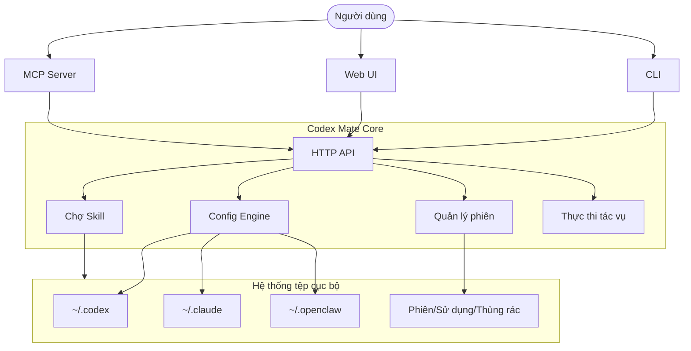

<div align="center">


# Codex Mate

**Tìm lại những cuộc trò chuyện nằm rải rác trong các công cụ lập trình AI.**

Codex Mate là công cụ CLI + Web chạy cục bộ, giúp xem, lọc và xuất các phiên đã có tại một nơi, đồng thời quản lý Provider, Skills và tác vụ khi cần.

<p>
  <a href="https://sakurabytecore.github.io/codexmate/">[Tài liệu]</a>
  <a href="#bắt-đầu-nhanh">[Bắt đầu nhanh]</a>
  <a href="README.md">[English]</a>
  <a href="README.zh.md">[简体中文]</a>
</p>

[](https://www.npmjs.com/package/codexmate)
[](https://github.com/SakuraByteCore/codexmate/actions/workflows/release.yml)
[](https://www.npmjs.com/package/codexmate)
[](#bắt-đầu-nhanh)
[](#bắt-đầu-nhanh)
[](https://nodejs.org/)
[](LICENSE)
[](https://github.com/SakuraByteCore/codexmate/stargazers)
[](https://github.com/SakuraByteCore/codexmate/issues)
[](https://stackmap.shipwithai.xyz/repos/SakuraByteCore/codexmate?utm_source=badge)

<br />

</div>

---

> [!TIP]
> **Ưu tiên cục bộ**: Đọc các phiên đã có và quản lý cấu hình trên máy của bạn. Không có telemetry, không cần tài khoản cloud của Codex Mate. Yêu cầu tới mô hình vẫn được gửi đến provider đã cấu hình; chạy cục bộ không có nghĩa là mô hình chạy ngoại tuyến.

## Codex Mate là gì?

Giải pháp tuần trước được thảo luận trong Codex hay Claude Code? Lọc phiên theo nguồn, dự án hoặc thời gian, mở cuộc trò chuyện để xem lại, rồi xuất thành Markdown để tham khảo.

Codex Mate quản lý công cụ và dữ liệu cục bộ đã có. Đây không phải mô hình AI mới và không thay thế trợ lý lập trình của bạn. Hãy bắt đầu bằng việc tìm lại một cuộc trò chuyện hữu ích, không cần cấu hình mọi công cụ trước.

[Bắt đầu sử dụng](#bắt-đầu-nhanh) · [Hướng dẫn phiên (tiếng Trung)](https://sakurabytecore.github.io/codexmate/guide/sessions)

## Bắt đầu nhanh

Chọn một cách cài đặt bên dưới, rồi chạy `codexmate run`. Mở địa chỉ được in trong terminal, chọn nguồn có dữ liệu trong trình duyệt phiên, mở cuộc trò chuyện và dùng chức năng xuất. Nếu chưa có dữ liệu cục bộ, hãy tạo cuộc trò chuyện trong công cụ gốc trước.

Bản xuất dùng để đọc và lưu trữ, không phải khôi phục toàn bộ trạng thái agent trong công cụ khác. Dùng `codexmate setup` khi cần cấu hình provider. Xem [hướng dẫn bắt đầu nhanh (tiếng Trung)](https://sakurabytecore.github.io/codexmate/guide/quick-start) để biết chi tiết.

### Cài đặt qua Homebrew (macOS / Linux)

```bash
brew tap SakuraByteCore/codexmate
brew install codexmate
```

Yêu cầu [Node.js](https://nodejs.org/) (`brew install node` nếu chưa có).

### Cài đặt qua npm

```bash
npm install -g codexmate
codexmate run
```

Nếu cổng mặc định `3737` bận, Codex Mate tự động thử cổng kế tiếp (`3738`, `3739`, ...). Để chỉ định cổng cố định:

```bash
CODEXMATE_PORT=8080 codexmate run
```

Windows PowerShell:

```powershell
$env:CODEXMATE_PORT=8080; codexmate run
```

### Cài đặt qua curl (Standalone)

```bash
curl -fsSL https://raw.githubusercontent.com/SakuraByteCore/codexmate/main/scripts/install.sh | bash
```

### Agent được hỗ trợ

- **Codex**: `npm install -g @openai/codex`
- **Claude Code**: `npm install -g @anthropic-ai/claude-code`
- **Gemini CLI**: `npm install -g @google/gemini-cli`
- **CodeBuddy**: `npm install -g @tencent-ai/codebuddy-code`
- **KiloCode**: `npm install -g @kilocode/cli` (`kilo` / `kilocode`)
- **OpenCode**: xem [tài liệu chính thức OpenCode](https://opencode.ai/)
- **OpenClaw**: xem [kho lưu trữ OpenClaw](https://github.com/moeru-ai/openclaw)
- **Pi**: phiên làm việc được phát hiện từ `~/.pi/agent/sessions`; cấu hình provider nằm ở `~/.pi/agent/models.json`, provider/model mặc định nằm ở `~/.pi/agent/settings.json`
- **Zed**: phiên agent được đọc chỉ-đọc từ cơ sở dữ liệu cục bộ của Zed (`threads/threads.db` trong thư mục dữ liệu) và hiển thị trong trình duyệt phiên

---

## Điểm nổi bật

Sau khi tìm lại cuộc trò chuyện, bạn có thể quản lý cấu hình, skill và tác vụ phục vụ công việc hằng ngày:
- **Trình duyệt phiên thống nhất**: Xem phiên cục bộ từ Codex, Claude Code, Gemini CLI, CodeBuddy Code, WorkBuddy, Pi, OpenCode và Zed tại một nơi. Khả năng tìm kiếm, xuất và xóa tùy thuộc nguồn; xem [hướng dẫn phiên (tiếng Trung)](https://sakurabytecore.github.io/codexmate/guide/sessions).
- **Bridge tương thích OpenAI**: Dùng Codex với bất kỳ UI nào hỗ trợ OpenAI bằng cách chuẩn hóa Responses API.
- **Dọn dẹp provider lỗi**: Kiểm tra route provider cục bộ của Codex/Claude, hiển thị cấu hình lỗi trong một modal và xóa hàng loạt các provider hỏng đã chọn mà không chạm vào mục khỏe mạnh hoặc được bảo vệ.
- **Chợ skill cục bộ**: Chia sẻ và nhập skill giữa các app agent khác nhau.
- **Điều phối tác vụ**: Lập kế hoạch và thực thi tác vụ phức tạp với theo dõi phụ thuộc.

---

## Tiến độ hiện tại

| Tính năng | Trạng thái | Mô tả |
| --- | --- | --- |
| **Quản lý Provider** | ✅ | Chuyển đổi provider/model cho Codex, Claude, OpenCode, KiloCode, OpenClaw và Pi |
| **Cấu hình Provider Pi** | ✅ | Quản lý provider Pi trong Web UI, ghi vào `~/.pi/agent/models.json` (giữ nguyên các trường không nhận dạng được) và chuyển đổi provider/model mặc định trong `~/.pi/agent/settings.json` |
| **Đồng bộ Agent trực tiếp** | ✅ | Giám sát cấu hình & trạng thái Codex/Claude theo thời gian thực |
| **Trình duyệt phiên** | ✅ | Xem và lọc phiên cục bộ; khả năng tìm kiếm và xuất Markdown tùy thuộc nguồn. Xem hướng dẫn phiên |
| **Phân tích sử dụng** | ✅ | Trực quan hóa xu hướng tin nhắn và dự án nổi bật |
| **Chợ skill cục bộ** | ✅ | Import/export skill giữa các app agent |
| **Hàng đợi tác vụ** | ✅ | Thực thi tác vụ theo DAG và xem log |
| **Bridge OpenAI** | ✅ | Chuyển đổi Codex Responses API sang định dạng OpenAI chuẩn |
| **Kiểm tra sức khỏe Provider** | ✅ | Kiểm tra route provider Codex/Claude, đánh dấu cấu hình lỗi và xóa hàng loạt các provider hỏng đã chọn một cách an toàn |
| **Mẫu Prompt** | ✅ | Plugin prompt tái sử dụng được với hỗ trợ biến |
| **Trình sửa tệp prompt** | ✅ | Chỉnh sửa CLAUDE.md / AGENTS.md (bao gồm `~/.config/opencode/AGENTS.md` của OpenCode) và dùng kho preset chung. Áp dụng preset chỉ cập nhật editor; cần lưu thủ công để ghi vào tệp. |
| **Tích hợp MCP** | ✅ | Expose tool và resource cục bộ qua MCP stdio |
| **Tự động cập nhật** | ✅ | Cập nhật nhanh qua `codexmate update` |

---

## Kiến trúc



---

## Lời cảm ơn

> [!IMPORTANT]
> Dự án đang ở giai đoạn đầu. Chúng tôi đang tìm kiếm các nhà phát triển để cùng xây dựng hệ sinh thái agent cục bộ!

Cảm ơn tất cả những người đóng góp cho Codex Mate ❤️

<a href="https://github.com/SakuraByteCore/codexmate/graphs/contributors">
  
</a>

## Giấy phép

Apache-2.0
