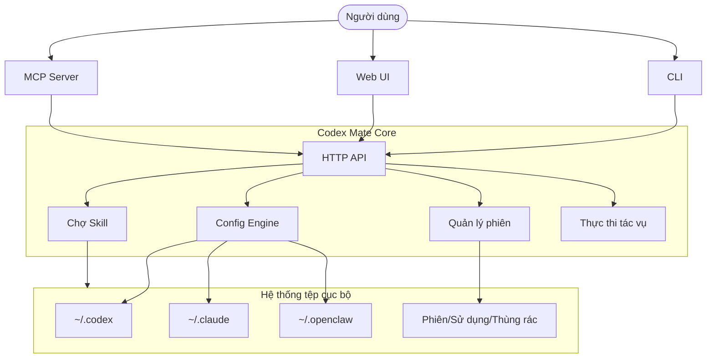

<div align="center">


# Codex Mate

**Tìm lại những cuộc trò chuyện nằm rải rác trong các công cụ lập trình AI.**

Codex Mate là công cụ CLI + Web chạy cục bộ, giúp xem, lọc và xuất các phiên đã có tại một nơi, đồng thời quản lý Provider, Skills và tác vụ khi cần.

<p>
  <a href="https://sakurabytecore.github.io/codexmate/">[Tài liệu]</a>
  <a href="#bắt-đầu-nhanh">[Bắt đầu nhanh]</a>
  <a href="README.md">[English]</a>
  <a href="README.zh.md">[简体中文]</a>
  <a href="README.tr.md">[Türkçe]</a>
</p>

[](https://www.npmjs.com/package/codexmate)
[](https://github.com/SakuraByteCore/codexmate/actions/workflows/release.yml)
[](https://www.npmjs.com/package/codexmate)
[](#bắt-đầu-nhanh)
[](#bắt-đầu-nhanh)
[](https://nodejs.org/)
[](LICENSE)
[](https://github.com/SakuraByteCore/codexmate/stargazers)
[](https://github.com/SakuraByteCore/codexmate/issues)
[](https://stackmap.shipwithai.xyz/repos/SakuraByteCore/codexmate?utm_source=badge)

<br />

</div>

### Chi tiết bản ghi sử dụng

Mở bản ghi UTC khi cần để tách token ghi nhận, các loại bộ nhớ đệm và ước tính toàn bộ văn bản đã lưu. Hỗ trợ bản ghi Codex, Claude, Pi và phiên Gemini JSON; biểu đồ và xuất mặc định giữ nguyên cách thống kê. Không tính chi phí. Dùng `codexmate analytics export --attribution records`. Xem [hướng dẫn sử dụng](https://sakurabytecore.github.io/codexmate/guide/sessions#%E7%94%A8%E9%87%8F%E8%AE%B0%E5%BD%95%E6%98%8E%E7%BB%86).

### Chia sẻ tệp

Chọn tệp hoặc thư mục rồi tải lên thủ công. Tải bản sao hoặc sao chép liên kết LAN có hiệu lực 60 phút. Tải xuống dùng cổng riêng, không cấp quyền API quản trị. Xóa lô hoặc dừng dịch vụ sẽ vô hiệu hóa liên kết và giữ nguyên tệp gốc. Xem [hướng dẫn chia sẻ tệp](https://sakurabytecore.github.io/codexmate/guide/web-ui#%E6%96%87%E4%BB%B6%E5%85%B1%E4%BA%AB).

### Chủ đề giao diện

Chọn Sáng, Tối, Đại dương hoặc Tím dịu trong phần cài đặt. Tím dịu tham khảo [Catppuccin Latte](https://github.com/catppuccin/palette), dùng nền sáng và điểm nhấn tím. Chủ đề được lưu tự động và khôi phục sau khi tải lại.

<a id="nhóm-định-tuyến"></a>
### Kiểm thử mô hình

Lựa chọn tab Codex/Pi được lưu và khôi phục sau khi tải lại. Chọn nhà cung cấp và mô hình trong cấu hình hiện có, nhập nội dung rồi gửi. Xem câu trả lời Markdown, ID mô hình trả về và thời gian tính bằng giây. Kiểm thử tiêu thụ hạn mức API; không mở CLI, đổi cấu hình hoặc lưu lịch sử. Mỗi lần chỉ gửi một yêu cầu, không tự thử lại, không đặt thời hạn phản hồi cục bộ và giới hạn đầu ra 2048 token. Hỗ trợ Responses, Chat Completions, Completions và Anthropic Messages đã cấu hình; chưa tích hợp đăng nhập gốc hoặc khóa lấy bằng lệnh. Web không còn hiển thị cài đặt nhóm; chức năng phân phối phía máy chủ và OpenAI Chat API giữ nguyên. Xem [hướng dẫn Web UI](https://sakurabytecore.github.io/codexmate/guide/web-ui).

Yêu cầu kiểm thử dùng UA/Originator của Codex hoặc header SDK của Pi; UA đã cấu hình được ưu tiên. Đọc thiết lập suy luận/đầu ra Codex và giới hạn token, tham số tương thích của mô hình Pi. Nếu không đọc được phiên bản khách đã cài, yêu cầu dùng định danh kiểm thử CodexMate có phiên bản, không giả tạo phiên bản khách.

### Không gian làm việc phiên

Trang phiên bổ sung dấu trang tin nhắn với ghi chú và nhãn, chỉ mục toàn văn cục bộ cập nhật tăng dần, bản nháp bàn giao có bằng chứng, không gian dự án chỉ đọc và tham chiếu cửa sổ mô hình. Dấu trang không sửa phiên gốc. Chỉ mục chỉ bao gồm phiên đã phát hiện; cần cập nhật để tìm tin nhắn mới. Tỷ lệ văn bản lịch sử không phải mức sử dụng thực tế của yêu cầu. Cài đặt cung cấp chẩn đoán cục bộ và xuất JSON/Markdown đã ẩn bí mật. Chỉ mục kiểm tra được chọn mới truy cập tuyến Codex hiện tại hoặc khởi động MCP; không gọi công cụ ghi. Xem [hướng dẫn phiên](https://sakurabytecore.github.io/codexmate/guide/sessions).

---

> [!TIP]
> **Ưu tiên cục bộ**: Đọc các phiên đã có và quản lý cấu hình trên máy của bạn. Không có telemetry, không cần tài khoản cloud của Codex Mate. Yêu cầu tới mô hình vẫn được gửi đến provider đã cấu hình; chạy cục bộ không có nghĩa là mô hình chạy ngoại tuyến.

## Codex Mate là gì?

Giải pháp tuần trước được thảo luận trong Codex hay Claude Code? Lọc phiên theo nguồn, dự án hoặc thời gian, mở cuộc trò chuyện để xem lại, rồi xuất thành Markdown để tham khảo.

Codex Mate quản lý công cụ và dữ liệu cục bộ đã có. Đây không phải mô hình AI mới và không thay thế trợ lý lập trình của bạn. Hãy bắt đầu bằng việc tìm lại một cuộc trò chuyện hữu ích, không cần cấu hình mọi công cụ trước.

[Bắt đầu sử dụng](#bắt-đầu-nhanh) · [Hướng dẫn phiên (tiếng Trung)](https://sakurabytecore.github.io/codexmate/guide/sessions) · [Bàn giao luồng](#bàn-giao-luồng)

## So sánh với các công cụ cùng nhóm

Chọn theo nhu cầu chính, không xem bảng này là danh sách tính năng loại trừ lẫn nhau. Các dự án có tính năng giao nhau và có thể dùng kết hợp.

| Công cụ | Trọng tâm chính | Nhu cầu phù hợp |
| --- | --- | --- |
| **Codex Mate** | Quản lý phiên và cấu hình xuyên công cụ, ưu tiên cục bộ, qua CLI + Web và ứng dụng máy tính | Tìm, lọc và xuất hội thoại từ nhiều công cụ tại một nơi, cùng quản lý Provider, Skills và quy trình tác vụ |
| [CC Switch](https://github.com/farion1231/cc-switch) | Trình quản lý cấu hình trên máy tính cho nhiều công cụ lập trình AI, gồm provider, MCP, Skills và lời nhắc | Chuyển đổi API provider và giảm việc sửa thủ công tệp cấu hình của từng công cụ |
| [CloudCLI (Claude Code UI)](https://github.com/siteboon/claudecodeui) | Giao diện Web trên máy tính và thiết bị di động cho Claude Code, Cursor CLI và Codex | Dùng trợ lý lập trình từ trình duyệt hoặc điện thoại, truy cập dự án và phiên cục bộ hoặc từ xa |
| [ccusage](https://github.com/ryoppippi/ccusage) | CLI phân tích lượng token sử dụng và chi phí từ dữ liệu cục bộ của tác nhân lập trình | Xem báo cáo lượng sử dụng và chi phí theo ngày, tuần, tháng hoặc phiên |

**Vì sao chọn Codex Mate?** Tập hợp tra cứu hội thoại xuyên công cụ, lưu trữ Markdown, quản lý cấu hình, Skills và tác vụ hằng ngày tại một nơi mà không thay thế trợ lý lập trình đang dùng.

So sánh dựa trên mô tả chính thức tại các liên kết trên; không hàm ý công cụ khác thiếu tính năng chưa liệt kê và không phải bảng xếp hạng hiệu năng hay giá. Thao tác phiên của Codex Mate tùy thuộc nguồn; xem [hướng dẫn phiên (tiếng Trung)](https://sakurabytecore.github.io/codexmate/guide/sessions). Xuất và bàn giao không di chuyển nguyên vẹn toàn bộ trạng thái phiên; chạy cục bộ cũng không có nghĩa là mô hình chạy ngoại tuyến.

## Bắt đầu nhanh

Để dùng CLI + Web, cài đặt qua Homebrew, npm hoặc curl bên dưới, rồi chạy `codexmate run`. Mở địa chỉ được in trong terminal, chọn nguồn có dữ liệu trong trình duyệt phiên, mở cuộc trò chuyện và dùng chức năng xuất. Nếu chưa có dữ liệu cục bộ, hãy tạo cuộc trò chuyện trong công cụ gốc trước.

Bản xuất dùng để đọc và lưu trữ, không phải khôi phục toàn bộ trạng thái agent trong công cụ khác. Dùng `codexmate setup` khi cần cấu hình provider. Xem [hướng dẫn bắt đầu nhanh (tiếng Trung)](https://sakurabytecore.github.io/codexmate/guide/quick-start) để biết chi tiết.

### Cài đặt ứng dụng máy tính

Mở [bản phát hành mới nhất](https://github.com/SakuraByteCore/codexmate/releases/latest). Các gói Windows `.exe`, macOS `.dmg` và Linux `.AppImage` chỉ xuất hiện trong mục **Assets** sau khi quá trình dựng ứng dụng máy tính hoàn tất. Tải gói dành cho nền tảng của bạn, cài đặt rồi mở trực tiếp ứng dụng máy tính; không cần chạy `codexmate run`.

### Cài đặt qua Homebrew (macOS / Linux)

```bash
brew tap SakuraByteCore/codexmate
brew install codexmate
```

Yêu cầu [Node.js](https://nodejs.org/) (`brew install node` nếu chưa có).

### Cài đặt qua npm

```bash
npm install -g codexmate
codexmate run
```

Nếu cổng mặc định `3737` bận, Codex Mate tự động thử cổng kế tiếp (`3738`, `3739`, ...). Để chỉ định cổng cố định:

```bash
CODEXMATE_PORT=8080 codexmate run
```

Windows PowerShell:

```powershell
$env:CODEXMATE_PORT=8080; codexmate run
```

### Cài đặt qua curl (Standalone)

```bash
curl -fsSL https://raw.githubusercontent.com/SakuraByteCore/codexmate/main/scripts/install.sh | bash
```

### Agent được hỗ trợ

- **Codex**: `npm install -g @openai/codex`
- **Claude Code**: `npm install -g @anthropic-ai/claude-code`
- **Gemini CLI**: `npm install -g @google/gemini-cli`
- **CodeBuddy**: `npm install -g @tencent-ai/codebuddy-code`
- **KiloCode**: `npm install -g @kilocode/cli` (`kilo` / `kilocode`)
- **OpenCode**: xem [tài liệu chính thức OpenCode](https://opencode.ai/)
- **OpenClaw**: xem [kho lưu trữ OpenClaw](https://github.com/moeru-ai/openclaw)
- **Pi**: phiên làm việc được phát hiện từ `~/.pi/agent/sessions`; cấu hình provider nằm ở `~/.pi/agent/models.json`, provider/model mặc định nằm ở `~/.pi/agent/settings.json`
- **Zed**: phiên agent được đọc chỉ-đọc từ cơ sở dữ liệu cục bộ của Zed (`threads/threads.db` trong thư mục dữ liệu) và hiển thị trong trình duyệt phiên

---

## Bàn giao luồng

Chuyển thẻ bàn giao có cấu trúc cho tác nhân đích qua MCP bộ nhớ dùng chung. Thao tác này không khôi phục toàn bộ trạng thái phiên. Lưu `card.json` với `goal` là chuỗi, còn `completed`, `blockers`, `nextSteps` và `files` là các mảng chuỗi:

```json
{
  "goal": "Hoàn tất cập nhật tài liệu",
  "completed": ["Đã xem hướng dẫn phiên"],
  "blockers": [],
  "nextSteps": ["Kiểm tra ví dụ trong các bản dịch"],
  "files": ["README.md"]
}
```

Chạy từ thư mục mã nguồn; sau khi cài đặt, thay `node cli.js` bằng `codexmate`:

```bash
node cli.js thread handoff <thread-id> --card <json-file> --target <agent>
node cli.js thread list <thread-id>
node cli.js thread fallback <thread-id> --handoff <id>
node cli.js thread ack <thread-id> --handoff <id> --agent <target> --evidence <session-or-retrieval-id>
```

Dùng mã bàn giao được trả về cho `<id>`, cùng tác nhân đích cho `<target>`, và mã phiên hoặc truy xuất thực tế làm bằng chứng. Chỉ chạy `ack` sau khi tác nhân đích tự báo đã đọc thẻ.

- **Lưu tệp trước, định tuyến MCP có giới hạn**: Trước tiên lưu tệp bàn giao tại `~/.codexmate/threads/<hash>/`. Dò tìm MCP bộ nhớ dùng chung bằng cách chỉ đọc `.mcp.json` của dự án, cấu hình người dùng Claude và `config.toml` của Codex, không sửa cấu hình. Chọn một MCP có công cụ ghi gốc tương thích, dùng kết nối ngắn hạn, không chạy tiến trình nền thường trực. Không bảo đảm tương thích với mọi phiên bản MCP. Không thêm phụ thuộc hay cơ chế ép chèn lời nhắc.
- **Dự phòng tệp tường minh**: Khi ghi MCP thất bại, hệ thống không tự thử lại và hiển thị đường dẫn tệp. `thread fallback` trả về nội dung văn bản của tệp. Nút sao chép thẻ trong khu vực bàn giao phiên của giao diện cũng là lựa chọn dự phòng tệp tường minh: vẫn phải tự dán thẻ vào tác nhân đích; sao chép không tự gửi.
- **Ghi thành công không xác nhận đã đọc**: Ghi MCP thành công chỉ đặt trạng thái `awaiting_read`, không chứng minh tác nhân đích đã đọc thẻ. `thread ack` ghi nhận việc tác nhân đích tự báo đã đọc kèm bằng chứng, không phải xác minh độc lập.
- **Nhật ký kiểm toán**: `thread list <thread-id>` trả về nhật ký gồm MCP/công cụ đã chọn, thời gian thực hiện, kết quả ghi, dự phòng và trạng thái đọc.

---

## Điểm nổi bật

Sau khi tìm lại cuộc trò chuyện, bạn có thể quản lý cấu hình, skill và tác vụ phục vụ công việc hằng ngày:
- **Trình duyệt phiên thống nhất**: Xem phiên cục bộ từ Codex, Claude Code, Gemini CLI, CodeBuddy Code, WorkBuddy, Pi, OpenCode và Zed tại một nơi. Khả năng tìm kiếm, xuất và xóa tùy thuộc nguồn; xem [hướng dẫn phiên (tiếng Trung)](https://sakurabytecore.github.io/codexmate/guide/sessions). Chi tiết phiên luôn hiển thị ước tính token theo năm nhóm, thanh tỷ lệ và mức sức khỏe ngữ cảnh.
- **Bridge tương thích OpenAI**: Dùng Codex với bất kỳ UI nào hỗ trợ OpenAI bằng cách chuẩn hóa Responses API.
- **Dọn dẹp provider lỗi**: Kiểm tra route provider cục bộ của Codex/Claude, hiển thị cấu hình lỗi trong một modal và xóa hàng loạt các provider hỏng đã chọn mà không chạm vào mục khỏe mạnh hoặc được bảo vệ.
- **Xem trước và hoàn tác cấu hình**: Hiển thị đường dẫn và khác biệt trường đã ẩn thông tin xác thực trước khi ghi cả sáu công cụ. Phát hiện sửa đổi bên ngoài sau khi tải hoặc xem trước; hoàn tác thay đổi gần nhất của từng công cụ, kể cả sau khi khởi động lại dịch vụ. Tùy chọn xem trước điều khiển hộp thoại; khi tắt vẫn giữ kiểm tra xung đột và hoàn tác.
- **Chợ skill cục bộ**: Chia sẻ và nhập skill giữa các app agent khác nhau.
- **Điều phối tác vụ**: Tự động thực thi quy trình hiện có, lưu bền vững tiến độ và kết quả, chỉ yêu cầu can thiệp khi bị chặn.

---

## Tiến độ hiện tại

| Tính năng | Trạng thái | Mô tả |
| --- | --- | --- |
| **Quản lý Provider** | ✅ | Chuyển đổi provider/model cho Codex, Claude, OpenCode, KiloCode, OpenClaw và Pi |
| **Cấu hình Provider Pi** | ✅ | Quản lý provider Pi trong Web UI, ghi vào `~/.pi/agent/models.json` (giữ nguyên các trường không nhận dạng được) và chuyển đổi provider/model mặc định trong `~/.pi/agent/settings.json` |
| **Đồng bộ Agent trực tiếp** | ✅ | Giám sát cấu hình & trạng thái Codex/Claude theo thời gian thực |
| **Trình duyệt phiên** | ✅ | Xem và lọc phiên cục bộ; khả năng tìm kiếm và xuất Markdown tùy thuộc nguồn. Xem hướng dẫn phiên |
| **Phân tích sử dụng** | ✅ | Trực quan hóa xu hướng tin nhắn và dự án nổi bật |
| **Chợ skill cục bộ** | ✅ | Import/export skill giữa các app agent |
| **Hàng đợi tác vụ** | ✅ | Quy trình tự động có phụ thuộc, lưu tiến độ, khôi phục an toàn và tổng kết kết quả |
| **Bridge OpenAI** | ✅ | Chuyển đổi Codex Responses API sang định dạng OpenAI chuẩn |
| **Kiểm tra sức khỏe Provider** | ✅ | Kiểm tra route provider Codex/Claude, đánh dấu cấu hình lỗi và xóa hàng loạt các provider hỏng đã chọn một cách an toàn |
| **Mẫu Prompt** | ✅ | Hộp thoại điền biến khi gọi, chia sẻ một mẫu bằng JSON, lịch sử Diff và khôi phục cấu hình mẫu plugin. `git_diff` là văn bản được dán, không thực thi lệnh. |
| **Trình sửa tệp prompt** | ✅ | Chỉnh sửa CLAUDE.md / AGENTS.md toàn cục và theo dự án với kho preset chung. Điền biến trước khi áp dụng preset; cần lưu thủ công để ghi tệp. Lịch sử hiển thị Diff; xác nhận khôi phục sẽ ghi phiên bản đã chọn với bản sao lưu nguyên tử và kiểm tra thay đổi bên ngoài. Tab Pi liệt kê tệp `.md` trực tiếp trong `~/.pi/agent/` hoặc `<cwd>/.pi/`, cập nhật khi mở tab hoặc danh sách tệp; không tự động nạp prompt. |
| **Tích hợp MCP** | ✅ | Expose tool và resource cục bộ qua MCP stdio |
| **Tự động cập nhật** | ✅ | Nhấp thông báo phiên bản mới trong Web UI để xem phiên bản và sao chép `codexmate update`. Chạy trên máy chủ dịch vụ rồi khởi động lại dịch vụ sau khi cập nhật thành công. Nhấp hoặc sao chép không thực thi cập nhật |

---

## Quy trình tự động không cần theo dõi liên tục

Tái sử dụng định nghĩa quy trình hiện có để backend tự động thực thi các bước sau khi gửi. Bảng quy trình trên trang tổng quan hỗ trợ gửi tác vụ, xem kết quả, tiếp tục sau khi bổ sung đầu vào và hủy các bước tiếp theo. Đóng trang không làm gián đoạn tác vụ; tác vụ không chạy khi dịch vụ dừng.

### Khởi động và sử dụng

Khởi động dịch vụ cục bộ trong một terminal và giữ dịch vụ hoạt động:

```bash
codexmate run --no-browser
```

Gửi tác vụ từ terminal khác. Dùng trường `id` trong bản ghi trả về làm `<runId>` cho các lệnh tiếp theo:

```bash
codexmate workflow list --json
codexmate workflow submit diagnose-config --json
codexmate workflow active-runs --json
codexmate workflow detail <runId> --json
codexmate workflow resume <runId> --input @input.json --json
codexmate workflow cancel <runId> --json
```

- `resume` chỉ tiếp tục tác vụ đang chờ can thiệp. Tệp `input.json` chứa toàn bộ đầu vào đã cập nhật; bỏ `--input` để giữ đầu vào ban đầu.
- Bước ghi cần cấp rõ quyền `--allow-write` và bật quyền ghi cấu hình của công cụ tương ứng. Kiểm tra tác động thực tế trước khi tiếp tục bước ghi có kết quả chưa xác định.
- CLI mặc định kết nối đến `127.0.0.1:3737`. Khi dùng cổng tùy chỉnh, đặt cùng giá trị `CODEXMATE_PORT` trong hai terminal. Khi dùng token truy cập, dịch vụ và bên gọi cần dùng cùng `CODEXMATE_HTTP_TOKEN`.
- Lệnh đồng bộ `codexmate workflow run` hiện có vẫn tương thích. `workflow runs` đọc lịch sử thực thi cũ; `workflow active-runs` đọc các bản ghi thực thi được lưu bền vững.

### Xử lý tự động và giới hạn an toàn

- Lưu bền vững bản chụp định nghĩa, đầu vào, trạng thái nút, toàn bộ đầu ra và số lần thử. Bản tổng kết gồm mục đã hoàn thành, kết quả cuối cùng và lý do các mục chưa hoàn thành.
- Sau khi khởi động lại dịch vụ, tiếp tục các nút chỉ đọc đã xác nhận an toàn, không chạy lại nút đã thành công. Nút ghi hoặc nút chưa phân loại có kết quả chưa xác định sẽ chờ can thiệp, không tự động chạy lại.
- Kiểm tra phụ thuộc được khai báo rõ ràng; giữ thứ tự thực thi tuần tự cho định nghĩa cũ. Không bao gồm tự động chia tác vụ từ ngôn ngữ tự nhiên.
- Chỉ thử lại lỗi chỉ đọc được đánh dấu rõ là có thể thử lại, trong giới hạn hữu hạn. `retry` nhận giá trị `0–5`, mặc định không thử lại. Thao tác ghi không tự động thử lại.
- Thiếu đầu vào bắt buộc hoặc quyền ghi sẽ tạm dừng để chờ can thiệp. Hủy chỉ ngăn các bước tiếp theo; công cụ đang chạy phải kết thúc trước khi việc hủy hoàn tất.
- Khi hết `timeoutMs`, gửi tín hiệu hủy nhưng vẫn chờ công cụ kết thúc thực sự. Công cụ không hỗ trợ tín hiệu này không bảo đảm thời hạn cứng; hệ thống không báo sai rằng công cụ đã dừng.
- Bật `workflow-completed`, `workflow-failed` và `workflow-waiting` trong cài đặt Webhook để nhận thông báo hoàn thành, thất bại hoặc cần can thiệp. Lỗi thông báo được ghi riêng, không thay đổi kết quả thực thi. Vẫn có thể tra cứu kết quả khi chưa cấu hình thông báo.

---

## Kiến trúc



---

## Lời cảm ơn

> [!IMPORTANT]
> Dự án đang ở giai đoạn đầu. Chúng tôi đang tìm kiếm các nhà phát triển để cùng xây dựng hệ sinh thái agent cục bộ!

Cảm ơn tất cả những người đóng góp cho Codex Mate ❤️

<a href="https://github.com/SakuraByteCore/codexmate/graphs/contributors">
  
</a>

## Giấy phép

Apache-2.0
