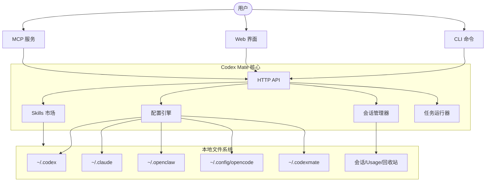

<div align="center">


# Codex Mate

**找回散落在不同 AI 编程工具里的对话。**

Codex Mate 是本地运行的 CLI + Web 管理工具，在一个界面查看、筛选和导出已有会话，也能集中管理 Provider、Skills 与任务。

<p>
  <a href="https://sakurabytecore.github.io/codexmate/">[项目文档]</a>
  <a href="#快速开始">[快速开始]</a>
  <a href="README.md">[English]</a>
</p>

[](https://www.npmjs.com/package/codexmate)
[](https://github.com/SakuraByteCore/codexmate/actions/workflows/release.yml)
[](https://www.npmjs.com/package/codexmate)
[](#homebrew-安装macos--linux)
[](#快速开始)
[](https://nodejs.org/)
[](LICENSE)
[](https://github.com/SakuraByteCore/codexmate/stargazers)
[](https://github.com/SakuraByteCore/codexmate/issues)
[](https://stackmap.shipwithai.xyz/repos/SakuraByteCore/codexmate?utm_source=badge)

<br />

</div>

---

> [!TIP]
> **本地优先**：读取本机已有会话、管理本地配置，无需 Codex Mate 云端账户，不收遥测。模型调用仍由所配置的 Provider 处理，本地运行不等于模型离线运行。

## 什么是 Codex Mate?

上周讨论过的方案，忘了是在 Codex 还是 Claude Code？先在会话浏览器按来源、项目或时间缩小范围，打开记录确认内容，再导出为 Markdown 留作参考。

Codex Mate 管理已有工具和本地记录，不是新的 AI 模型，也不替代原来的编程助手。第一次使用不必配置全部工具；先找回一段对话即可。

[开始使用](#快速开始) · [查看会话使用方法](https://sakurabytecore.github.io/codexmate/guide/sessions)

## 快速开始

先任选一种方式安装，再运行 `codexmate run`。按终端显示的地址打开 Web UI，在「会话来源」选已有记录的工具，打开一条会话并点击「导出记录」。没有本地记录时，先在原工具中产生一段对话。

导出用于阅读与归档，不等于在另一工具中恢复完整状态。需要配置 Provider 时再使用 `codexmate setup`；详细步骤见[快速开始](https://sakurabytecore.github.io/codexmate/guide/quick-start)。

### Homebrew 安装（macOS / Linux）

```bash
brew tap SakuraByteCore/codexmate
brew install codexmate
```

需要 [Node.js](https://nodejs.org/)（如未安装可执行 `brew install node`）。

### 通过 npm 安装

```bash
npm install -g codexmate
codexmate run
```

如果默认 Web UI 端口 `3737` 不可用，Codex Mate 会自动尝试后续端口（`3738`、`3739` ...）。如需固定端口，可以指定 `CODEXMATE_PORT`：

```bash
CODEXMATE_PORT=8080 codexmate run
```

Windows PowerShell：

```powershell
$env:CODEXMATE_PORT=8080; codexmate run
```

### 通过 curl 安装 (独立包)

```bash
curl -fsSL https://raw.githubusercontent.com/SakuraByteCore/codexmate/main/scripts/install.sh | bash
```

### 支持的智能体

- **Codex**: `npm install -g @openai/codex`
- **Claude Code**: `npm install -g @anthropic-ai/claude-code`
- **Gemini CLI**: `npm install -g @google/gemini-cli`
- **CodeBuddy**: `npm install -g @tencent-ai/codebuddy-code`
- **KiloCode**: `npm install -g @kilocode/cli`（`kilo` / `kilocode`）
- **OpenCode**: 参照 [OpenCode 官方文档](https://opencode.ai/) 安装
- **OpenClaw**: 参见 [OpenClaw 仓库](https://github.com/moeru-ai/openclaw)
- **Pi**: 会话从 `~/.pi/agent/sessions` 自动发现；供应商配置位于 `~/.pi/agent/models.json`，默认供应商/模型位于 `~/.pi/agent/settings.json`
- **Zed**: 智能体会话从 Zed 本地数据库（其数据目录下的 `threads/threads.db`）只读发现，并在会话浏览器中列出

---

## 有什么独特之处？

找回对话之后，还可以继续管理日常工作所需的配置、Skills 与任务：
- **统一会话浏览器**：集中浏览 Codex、Claude Code、Gemini CLI、CodeBuddy Code、WorkBuddy、Pi、OpenCode 与 Zed 的本地会话；检索、导出和删除的来源限制见[会话指南](https://sakurabytecore.github.io/codexmate/guide/sessions)。
- **OpenAI 兼容桥接**：通过归一化 Responses API，让 Codex 能够与任何支持 OpenAI 格式的 UI 配合使用；内建 Codex 转换会补齐并规范化 `User-Agent`、`Version`、`OpenAI-Beta`、`Originator` 等 Codex 指纹，对上游伪装为官方 Codex CLI 请求。
- **Claude Provider 桥接**：通过内建本地 Claude 兼容代理，让 Claude Code 接入 OpenAI Chat Completions 兼容 provider 与 Ollama。
- **OpenCode Provider 控制**：在 `~/.codexmate` 下维护 CodexMate 自有的 OpenCode 多 provider 存储，只将当前选中的 provider 投影到 OpenCode 原生配置，避免污染或误删用户已有配置。
- **Pi Provider 配置**：在 Web UI 中管理 Pi 供应商，写入 `~/.pi/agent/models.json` 时无损保留未知字段，支持自动拉取远端模型列表，并可一键切换 `~/.pi/agent/settings.json` 中的默认供应商/模型。
- **Provider 健康清理**：探测本地 Codex 与 Claude provider 路由，在同一个弹窗里集中展示失败配置，并批量清理已选坏配置，不影响正常或受保护项。
- **Skills 市场**：本地优先的市场，支持在不同的智能体应用之间共享和导入 Skills。
- **提示词文件编辑器**：统一编辑全局和项目级 `CLAUDE.md` 与 `AGENTS.md`（含 OpenCode 的 `~/.config/opencode/AGENTS.md`），支持项目路径自动检测，并提供通用预设池复用 prompt。
- **任务编排器**：支持带有依赖跟踪的复杂任务规划与执行。

---

## 当前进展

| 特性 | 状态 | 描述 |
| --- | --- | --- |
| **Provider 管理** | ✅ | 切换 Codex、Claude、OpenCode、KiloCode、OpenClaw 与 Pi 的 provider/model |
| **状态实时同步** | ✅ | 实时感知 Codex/Claude 的配置与运行状态变更 |
| **会话浏览器** | ✅ | 集中浏览与筛选本地会话，按来源提供检索、Markdown 导出等操作；详见会话指南 |
| **Usage 统计** | ✅ | 可视化消息趋势与热门项目统计 |
| **本地 Skills 市场** | ✅ | 跨应用的智能体 Skills 导入与导出 |
| **任务队列** | ✅ | 基于 DAG 的任务执行与日志查看 |
| **OpenAI 桥接** | ✅ | 将 Codex Responses API 转换为标准 OpenAI 格式，并在内建转换中附加/规范化 Codex 指纹 |
| **Claude Provider 桥接** | ✅ | 通过内建 Claude 兼容代理，让 Claude Code 接入 OpenAI Chat Completions 兼容 provider 与 Ollama |
| **OpenCode Provider 存储** | ✅ | 在 `~/.codexmate` 中保留多个 OpenCode provider，只将当前选中的 provider 投影到 OpenCode 原生配置 |
| **Pi Provider 配置** | ✅ | 在 Web UI 中管理 Pi 供应商，写入 `~/.pi/agent/models.json`（未知字段无损保留），并切换 `~/.pi/agent/settings.json` 中的默认供应商/模型 |
| **Provider 健康检查** | ✅ | 探测本地 Codex/Claude provider 路由，标记失败配置，并安全批量移除已选坏配置 |
| **提示词模板** | ✅ | 支持变量的可复用提示词插件 |
| **提示词文件编辑器** | ✅ | 编辑全局和项目级 CLAUDE.md / AGENTS.md，支持自动检测、路径切换与通用预设池。应用预设只更新编辑器，需手动保存才会写入文件。 |
| **MCP 集成** | ✅ | 通过 MCP stdio 暴露本地工具与资源 |
| **自动更新** | ✅ | 通过 `codexmate update` 快速更新 CLI |

---

## 架构总览



---

## 特别鸣谢

> [!IMPORTANT]
> 本项目目前处于早期开发阶段。我们正在寻找开发者共同构建本地智能体生态！

感谢所有贡献者对 Codex Mate 的辛勤付出 ❤️

<a href="https://github.com/SakuraByteCore/codexmate/graphs/contributors">
  
</a>

## 开源协议

Apache-2.0
